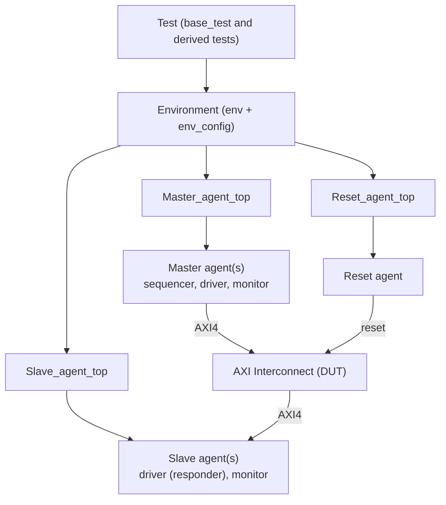

# AXI-Interconnect-with-multiple-masters-slaves---UVM-Verification
UVM-based verification environment for an AXI4 interconnect. Features multi-master/multi-slave agents with env_config-driven agent counts, one reset agent, semaphore-synchronized drivers and monitors across AW/W/B/AR/R channels, and tests for FIXED, INCR, WRAP, random and arbitration scenarios. Built with SystemVerilog, VCS and QuestaSim.


A **UVM-based verification environment** for an **AXI4 interconnect** that connects multiple masters to multiple slaves. The testbench drives and monitors all five AXI channels, checks different burst types, and tests how the interconnect arbitrates between masters.


---

## Table of Contents

1. [Overview](#overview)
2. [Key Features](#key-features)
3. [Testbench Architecture](#testbench-architecture)
4. [Repository Structure](#repository-structure)
5. [Testcases](#testcases)
6. [How the Testbench Works](#how-the-testbench-works)
7. [Tools Used](#tools-used)
8. [How to Run](#how-to-run)
9. [Author](#author)

---

## Overview

**AXI (Advanced eXtensible Interface)** is a high-performance on-chip bus protocol from ARM. It uses five independent channels:

| Channel | Name | Purpose |
|---------|------|---------|
| **AW** | Write Address | Master sends the write address and control info |
| **W**  | Write Data | Master sends the write data |
| **B**  | Write Response | Slave confirms the write is complete |
| **AR** | Read Address | Master sends the read address and control info |
| **R**  | Read Data | Slave returns the read data and response |

An **interconnect** sits between several masters and several slaves, routes each transaction to the right slave, and decides who gets access when more than one master wants the bus at the same time.

This project verifies that interconnect using a reusable, configurable UVM testbench.

---

## Key Features

- **Multi-master / multi-slave setup** – the number of master and slave agents is controlled through `env_config`, so the environment can be resized without editing the agent code.
- **Dedicated reset agent** – a separate agent generates and controls reset.
- **All five AXI channels covered** – drivers, monitors and the slave responder handle AW, W, B, AR and R.
- **Semaphore-based synchronization** – semaphores keep the channels in step with each other and give each channel mutual exclusion, so independent channels do not collide.
- **Burst-type testing** – FIXED, INCR and WRAP bursts.
- **Random and arbitration tests** – random traffic and multi-master contention scenarios.
- **Analysis port connectivity** – monitors collect channel activity and publish transactions through an analysis port.

---

## Testbench Architecture



**In short:** the test starts a sequence on the master side, the master driver sends AXI transactions into the interconnect, the interconnect routes them to a slave, and the slave driver responds. Monitors watch the bus on both sides.

---

## Repository Structure

```
.
├── Master_agent_top/   # Master agent(s): driver, monitor, sequencer, sequences
├── Slave_agent_top/    # Slave agent(s): responder driver, monitor
├── Reset_agent_top/    # Reset agent
├── Tb/                 # Testbench top, environment and env_config
├── Test/               # UVM tests (base_test, fixed, incr, wrap, random, arbitration)
├── RTL/                # AXI interconnect design (DUT)
├── Sim/                # Simulation scripts and run area
└── README.md
```

---

## Testcases

Every test extends `base_test` and runs a matching `master_sequence` subclass.

| Test | What it checks |
|------|----------------|
| `base_test` | Builds the environment and configuration; parent of all other tests |
| `test_fixed` | **FIXED** bursts – the address stays the same for every beat |
| `test_incr` | **INCR** bursts – the address increases with every beat |
| `test_wrap` | **WRAP** bursts – the address wraps around at the burst boundary |
| `test_random` | Randomized transactions to reach varied scenarios |
| `test_arbitration` | Several masters request access together to exercise the interconnect's arbitration |

---

## How the Testbench Works

### Master side
- The **master driver** takes transactions from the sequencer and drives the AW, W, B, AR and R channels.
- The **master monitor** observes the same channels and sends the collected transactions out through its **analysis port**.

### Slave side
- The **slave driver** acts as the memory/peripheral: it responds on the AW, W, B, AR and R channels.
- The **slave monitor** observes activity at the slave interface.

### Channel synchronization with semaphores
The AXI channels are independent, but a transaction on one channel often depends on another (for example, a write response only makes sense after the write address and data). The drivers and monitors use **semaphores** to:

- **hand off** between channels in the correct order, and
- give each channel **mutual exclusion**, so two processes never drive or sample the same channel at the same time.

### Configuration
`env_config` holds the setup of the environment (such as how many master and slave agents to create), so the same testbench can be reused for different interconnect sizes.

---

## Tools Used

| Purpose | Tool |
|---------|------|
| Language | SystemVerilog |
| Methodology | UVM (Universal Verification Methodology) |
| Simulators | Synopsys VCS, Siemens QuestaSim |
| Waveform debug | Verdi |

---

## How to Run

> Adjust the file names below to match the scripts inside the `Sim/` folder.

1. Clone the repository:
   ```bash
   git clone https://github.com/Thiruvalluvar2105/AXI-Interconnect-with-multiple-masters-slaves---UVM-Verification.git
   cd AXI-Interconnect-with-multiple-masters-slaves---UVM-Verification/Sim
   ```

2. Compile and simulate with your tool of choice, selecting the test with `+UVM_TESTNAME`:

   **VCS**
   ```bash
   vcs -sverilog -full64 -ntb_opts uvm <file_list> -o simv
   ./simv +UVM_TESTNAME=test_incr
   ```

   **QuestaSim**
   ```bash
   vlib work
   vlog -sv +incdir+<include_dirs> <file_list>
   vsim -c top +UVM_TESTNAME=test_incr -do "run -all; quit"
   ```

3. Change `+UVM_TESTNAME` to run a different test:
   `test_fixed`, `test_incr`, `test_wrap`, `test_random`, `test_arbitration`.

4. Open the waveform in Verdi or the simulator's viewer to debug.

---

## Author

**Thiruvalluvar**
VLSI Design & Verification | SystemVerilog · UVM · RTL Design

GitHub: [@Thiruvalluvar2105](https://github.com/Thiruvalluvar2105)
